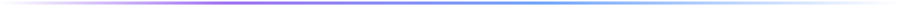

  
  

  

    
    
    
  

  

    <a href="#about">About</a> ·
    <a href="#tech-stack">Tech Stack</a> ·
    <a href="#github-stats">GitHub Stats</a> ·
    <a href="#connect">Connect</a>
  

  

## About

I'm a full-stack developer focused on shipping production-ready products — clean, responsive front-ends, well-structured APIs and reliable deployments. I care about clarity, performance and maintainable architecture.

<table>
  <tr>
    <td>💼 <strong>Experience</strong></td>
    <td>Freelance Developer · Khamsat (2019 – 2022) — 2+ client projects shipped</td>
  </tr>
  <tr>
    <td>🎓 <strong>Education</strong></td>
    <td>M.Sc. Computer Science — Data Engineering &amp; Web Technology · Université Ferhat Abbas Sétif (2022 – 2024)</td>
  </tr>
  <tr>
    <td>🌍 <strong>Based in</strong></td>
    <td>Algeria (GMT+1) · open to freelance &amp; collaboration</td>
  </tr>
  <tr>
    <td>🗣️ <strong>Languages</strong></td>
    <td>Arabic (native) · English (professional) · French (basic)</td>
  </tr>
  <tr>
    <td>🎮 <strong>Beyond code</strong></td>
    <td>Video games · always learning</td>
  </tr>
</table>

## Tech Stack

**Languages**

**Frameworks & Libraries**

**Databases & DevOps**

**Tools & Platforms**

## GitHub Stats

  
  
  
  

## Connect

  
  
  
  
  
  
  

  

  Thanks for stopping by · Always building, always learning.

