# Houssem Eddine Dahel

**Full-Stack Developer · Laravel & React**

I build production-ready web platforms, scalable APIs and clean user interfaces.

[About](#about) · [Tech Stack](#tech-stack) · [GitHub Stats](#github-stats) · [Connect](#connect)

---

## About

I'm a full-stack developer focused on shipping production-ready products — from clean, responsive front-ends to well-structured APIs and deployments. I work mainly with **Laravel** and **React**, and I care about clarity, performance and maintainable architecture.

- 🔭 **Currently:** freelance web development & continuous learning
- 🎓 **Education:** Master's in Computer Science — Data Engineering & Web Technology
- 🌍 **Based in:** Algeria · open to freelance and collaboration
- 🎮 **Beyond code:** video games

## Tech Stack

**Languages**

**Frameworks & Libraries**

**Databases & DevOps**

**Tools & Platforms**

## GitHub Stats

  
  

## Connect

  
  
  
  
  
  
  

---

  Thanks for stopping by · Always building, always learning.

